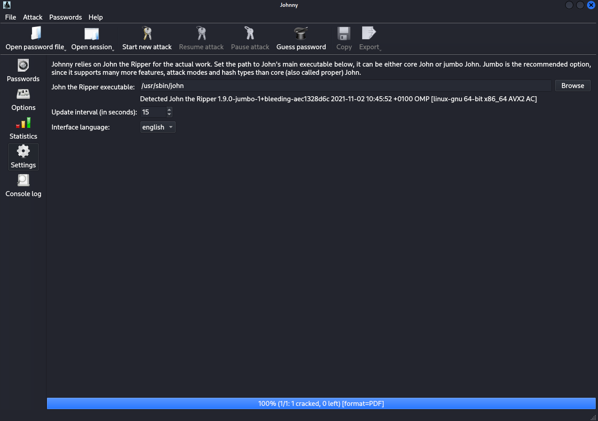
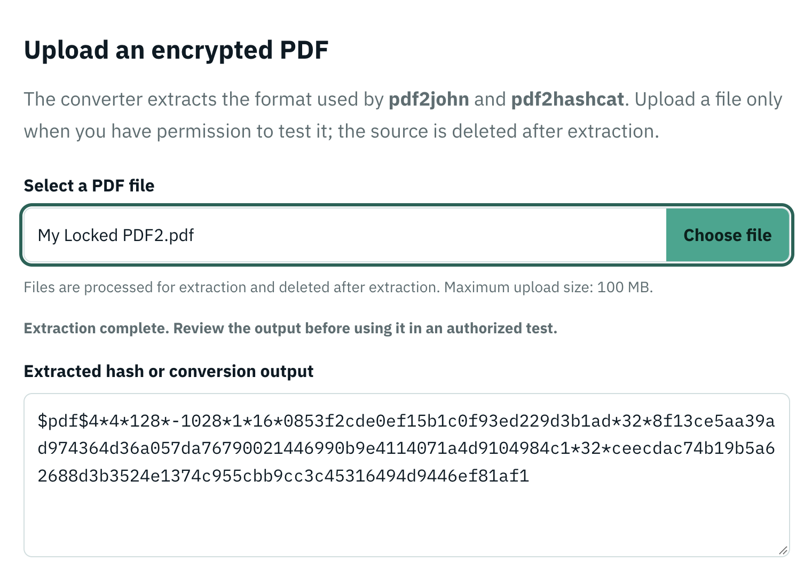
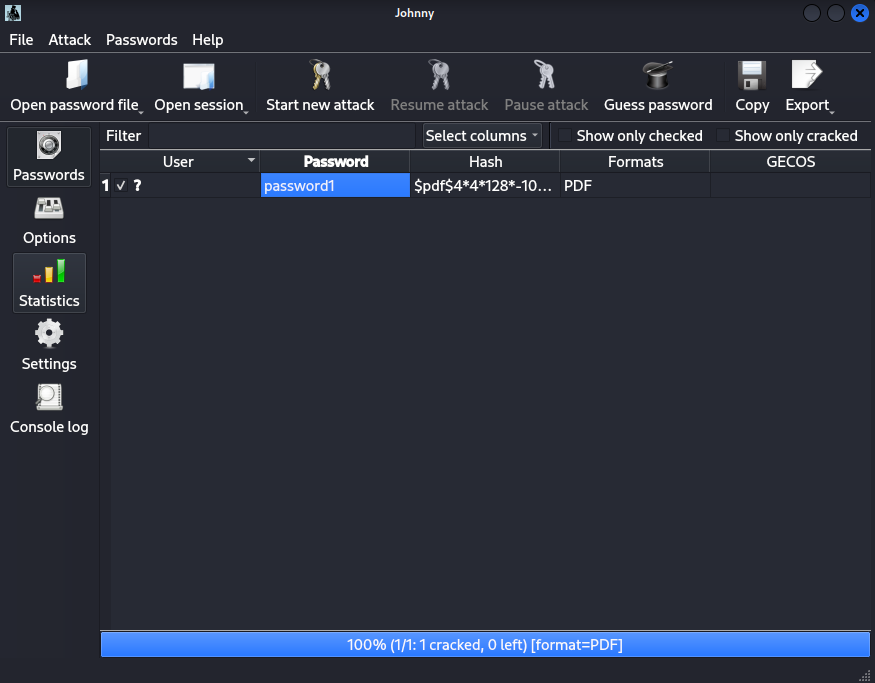
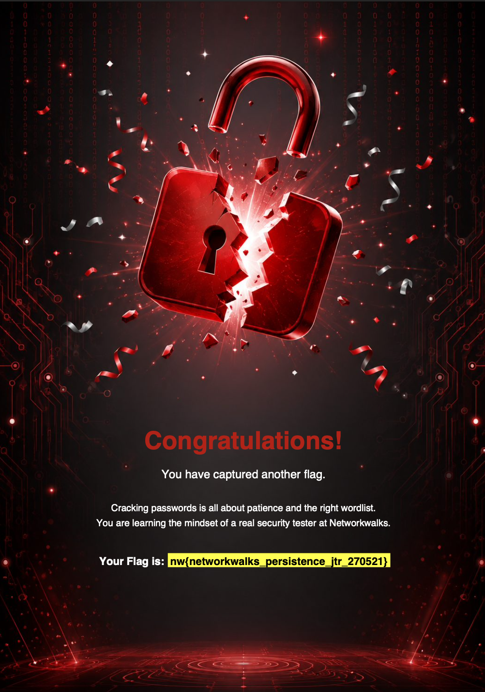
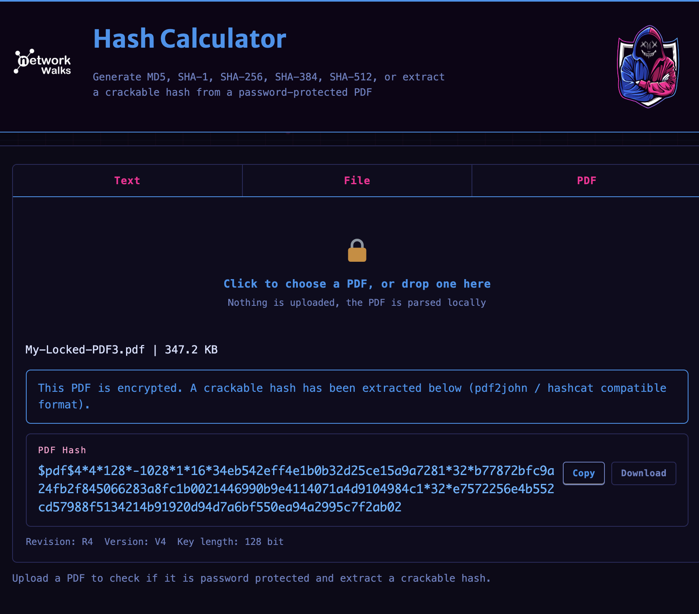
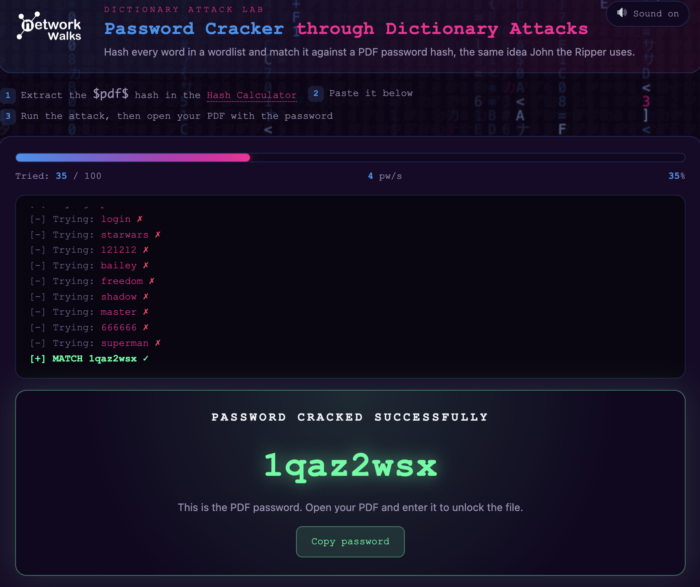
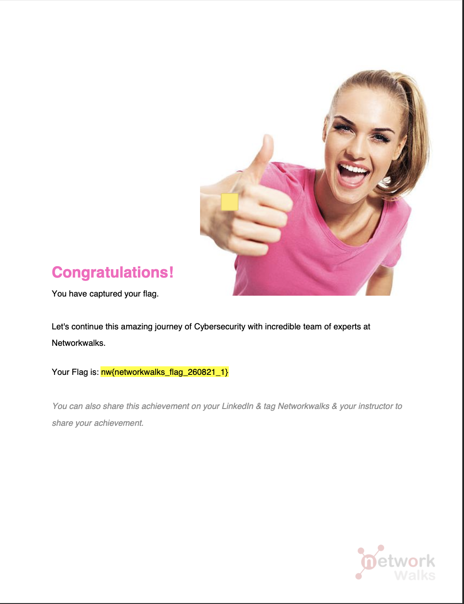

# Password Cracking 

>  Hands-on password cracking labs completed during **Week 3** of my Cybersecurity Internship at **NETWORKWALKS**.

---

## Overview

This repository contains my **Week 3 Cybersecurity Internship labs** focused on password cracking, hash analysis, and password security.

The labs demonstrate password auditing techniques using:

- John the Ripper
- Johnny GUI
- Networkwalks Hash Calculator
- Networkwalks Password Cracker

---

###  W3-PM1 — John the Ripper + Johnny GUI

#### Objective

Crack the password of a password-protected PDF using **John the Ripper (JTR)** and its graphical interface, **Johnny**.

####  Tools Used

| Tool | Purpose |
|---|---|
| John the Ripper 1.9.0-jumbo-1 | Password cracking |
| Johnny GUI 2.2 | Graphical interface for JTR |
| Online Hash Crack | Extract PDF password hash |

#### Methodology

1. Used JTR(John the Ripper) in Kali Linux.
2. Installed Johnny GUI in Kali Linux.
3. Configured Johnny to use `john.exe`.
4. Extracted the PDF hash.
5. Saved the extracted hash into `hash.txt`.
6. Loaded the hash into Johnny.
7. Performed a dictionary attack.
8. Successfully recovered the password.

#### Result

**Cracked Password:**

`password1`

#### Screenshots

##### 03 — Johnny Settings

##### 04 — Hash Extracted

##### 06 — Password Cracked

##### 08 — After Entering Password

---

###  W3-PM2 — Networkwalks Online Tools

####  Objective

Crack the password of a password-protected PDF using **Networkwalks online security tools**.

####  Tools Used

| Tool | Purpose |
|---|---|
| Networkwalks Hash Calculator | Generate/extract PDF hash |
| Networkwalks Password Cracker | Password security testing |

####  Methodology

1. Uploaded the PDF to the Networkwalks Hash Calculator.
2. Generated the PDF hash.
3. Copied the generated hash.
4. Pasted the hash into the Password Cracker.
5. Ran the available dictionary attack.
6. Successfully recovered the password.

####  Result

**Cracked Password:**

`1qaz2wsx`

#### Screenshots

##### 01 — Hash Calculator

##### 02 — Password Cracker

##### 05 — Unlocked pdf

---

##  Flags Captured

| Module | Flag |
|---|---|
| W3-PM1 | `nw{networkwalks_persistence_itr_270521}` |
| W3-PM2 | `nw{networkwalks_flag_260821_1}` |

---

## Key Learnings

### Hashing vs Encryption

**Hashing** is generally a one-way transformation used to represent data as a fixed-length value.

**Encryption** is a reversible process where encrypted information can be decrypted using an appropriate key.

Understanding this distinction is important when studying password storage and password attacks.

---

##  Password Security Lessons

Strong passwords should:

-  Be long and unique
-  Use uppercase and lowercase characters
-  Include numbers and special characters
-  Avoid common words
-  Avoid predictable patterns
-  Never be reused across multiple accounts

Additional protection can be provided through:

-  Password managers
-  Multi-factor authentication
-  Strong password policies
-  Account lockout and rate limiting

---

## Real-World Relevance

Password-cracking techniques are useful during authorized cybersecurity assessments for:

- Evaluating password policies
- Identifying weak credentials
- Security awareness and education
- Testing password-protection mechanisms
- Understanding attacker techniques

The purpose of ethical password auditing is to identify weaknesses **before malicious attackers can exploit them**.

---

## Tools & Resources

| Tool | Purpose | Link |
|---|---|---|
| John the Ripper | Password auditing and cracking |
| Johnny GUI | GUI for John the Ripper | 
| Networkwalks | Cybersecurity training/tools | 

---

## Lab Summary

| Lab | Tool | Attack Type | Result |
|---|---|---|---|
| W3-PM1 | JTR + Johnny | `password1` |
| W3-PM2 | NW Tools |`1qaz2wsx` |

---

#  Author

**Saba Fatima**

LinkedIn: [https://www.linkedin.com/in/sabafatimamin/](https://www.linkedin.com/in/sabafatimamin/)

---

## Disclaimer

> This repository was created for educational and cybersecurity training purposes only.
>
> All password-cracking techniques demonstrated here were performed against authorized files and systems as part of a formal training environment.
>
> Unauthorized access, password cracking, or testing of systems without permission may be illegal.

---
